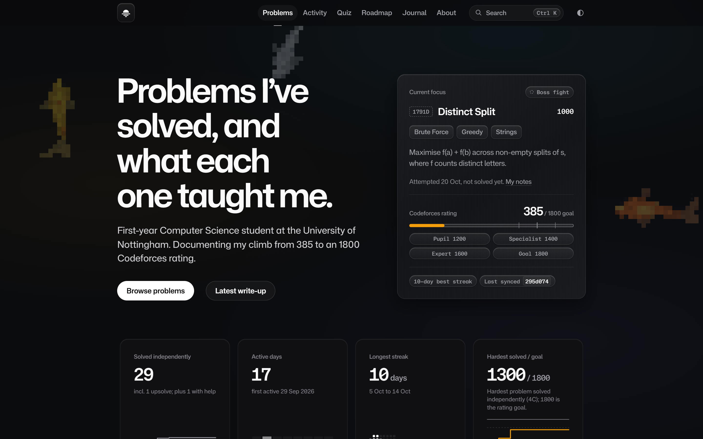
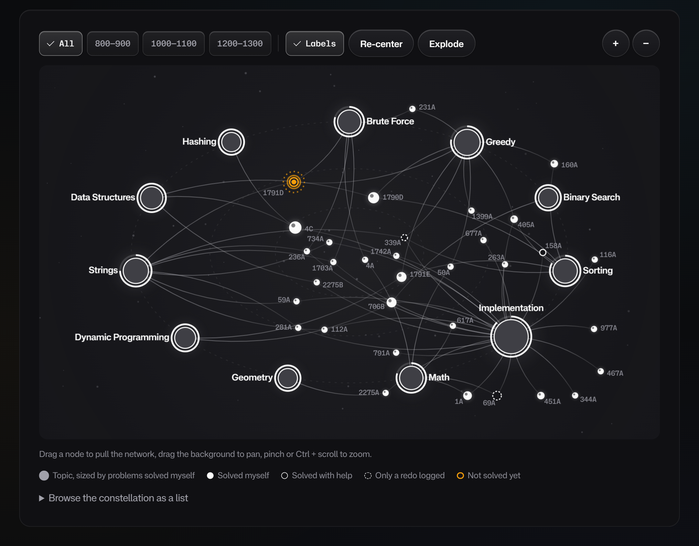
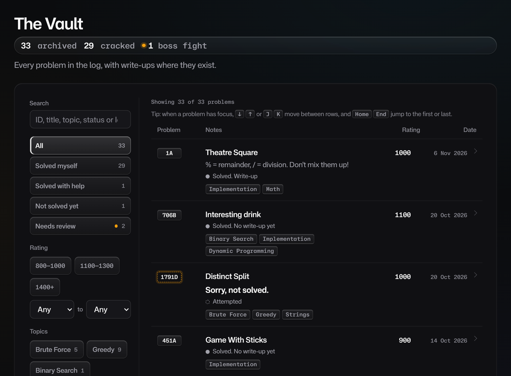
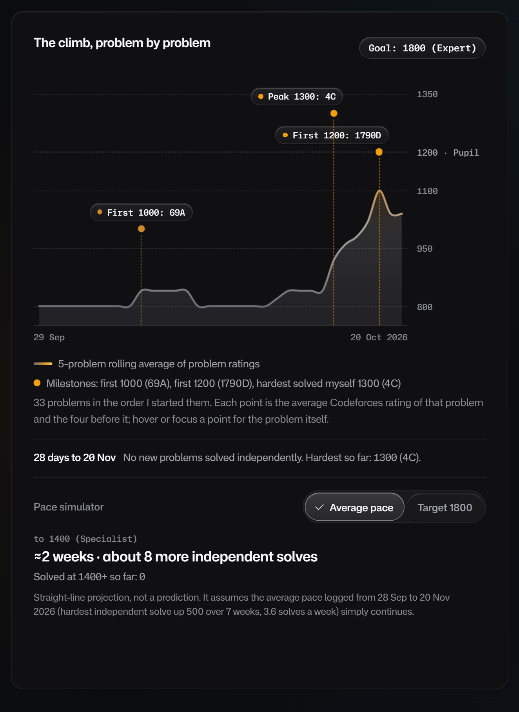
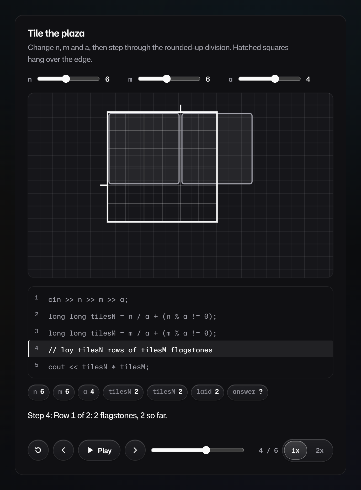

<div align="center">


<h1>Zain's Blog — Road to 1800</h1>

<p>First-year Computer Science student at the University of Nottingham<br>documenting my competitive programming climb from 385 to 1800.</p>

<p>
  <a href="https://zainkashifcs.github.io"><b>Live Site</b></a>
  &nbsp;·&nbsp;
  <a href="https://codeforces.com/profile/amaza1nn"><b>Codeforces</b></a>
  &nbsp;·&nbsp;
  <a href="https://zainkashifcs.github.io/#index"><b>Problem Index</b></a>
</p>

<br>

<picture>
  <source media="(prefers-color-scheme: dark)" srcset="assets/readme/hero-dark.png">
  <source media="(prefers-color-scheme: light)" srcset="assets/readme/hero-light.png">
  
</picture>

</div>

<br>

<table>
  <tr>
    <td width="50%" valign="top">
      
      <br><sub><b>Knowledge Constellation</b> · topics and problems as a force-directed graph</sub>
    </td>
    <td width="50%" valign="top">
      
      <br><sub><b>The Vault</b> · the whole archive, filterable by status, rating and topic</sub>
    </td>
  </tr>
  <tr>
    <td width="50%" valign="top">
      
      <br><sub><b>The climb</b> · a rolling-average curve with milestones and a pace simulator</sub>
    </td>
    <td width="50%" valign="top">
      
      <br><sub><b>Dry-run visualizers</b> · step through the solution line by line</sub>
    </td>
  </tr>
</table>

## What's inside

- **Spring motion engine** — a semi-implicit Euler spring that retargets mid-flight, so rapid clicks never snap or queue. It drives the gliding glass pills and the rubber-band edges on horizontal scrollers. Sections reveal on the way down and on the way back up. No animation library. &nbsp;`assets/js/motion-engine.js` · `motion.js`
- **Liquid Glass and brushed-metal tokens** — matte cards, glass rims kept to small chips and keycaps, and a machined-metal gradient for the hero's Current focus card. Every colour is a CSS custom property, with matching light and dark themes. &nbsp;`assets/css/style.css`
- **Knowledge Constellation** — a canvas force-directed graph of every topic and problem, generated from the archive at build time. Drag, flick, zoom and filter by rating; labels steer clear of every node. &nbsp;`assets/js/constellation-graph.js`
- **Dry-run visualizers** — interactive step-throughs of the C++ solutions for [1A](https://zainkashifcs.github.io/posts/1a-theatre-square/), [263A](https://zainkashifcs.github.io/problems/263a-beautiful-matrix/), [405A](https://zainkashifcs.github.io/problems/405a-gravity-flip/), [1791D](https://zainkashifcs.github.io/problems/1791d-distinct-split/), [2188B](https://zainkashifcs.github.io/problems/2188b-seats/) and [433B](https://zainkashifcs.github.io/problems/433b-kuriyama-mirai-s-stones/), drawn in SVG, with play, step and scrub controls and inputs you can change. &nbsp;`assets/js/algo-visualizer.js`
- **1-Minute Recall** — one quiz question on the homepage, picked due first, then unseen. Answers are checked instantly. Questions are drafted against the real solution code and published only after a human approves them. &nbsp;`_includes/recall-card.html` · `assets/js/quiz.js`
- **`make_post.py`** — turns the header comment of a solution `.cpp` file into a write-up. &nbsp;`make_post.py`
- **Hands-off data** — a scheduled GitHub Action syncs activity from the solutions repository every six hours, rebuilds the problem archive, refreshes the public Codeforces profile, validates everything and deploys. &nbsp;`.github/workflows/sync-and-deploy.yml` · `_scripts/`

All motion respects `prefers-reduced-motion`. Without JavaScript, the constellation falls back to a plain list and the recall card to a single question with its answer.

## Local development

```bash
bundle install
bundle exec jekyll serve                               # http://127.0.0.1:4000
python make_post.py "path/to/1_A_Theatre_Square.cpp"   # create or update a write-up
```

`make_post.py` reads the comment header at the top of a solution:

```cpp
// Problem: 1A Theatre Square
// Link: https://codeforces.com/problemset/problem/1/A
// Tags: math, implementation
// Idea: ...
// Stuck: ...
// Lesson: ...
```

Optional fields (`Rating`, `Summary`, `Solved`, `Status`) are documented at the top of [`make_post.py`](make_post.py).

| Layer | Stack |
| :-- | :-- |
| Site | Jekyll and Liquid, built by GitHub Pages |
| Interaction | Vanilla JavaScript (ES2020+), with Lenis for smooth scrolling |
| Graphics | HTML5 Canvas and inline SVG |
| Tooling | Python 3 standard library, GitHub Actions |
| Hosting | GitHub Pages |
